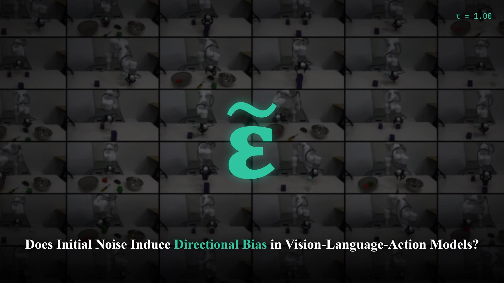

<h1 align="center">ε̃: Does Initial Noise Induce <i>Directional Bias</i> in Vision-Language-Action Models?</h1>

<p align="center">
  <a href="https://junmyeong-lee.github.io/">Junmyeong Lee</a>,
  <a href="https://scholar.google.com/citations?user=li5M6YkAAAAJ">Dongmin Shin</a>,
  <a href="https://vvsjeon.github.io/">Wooseok Jeon</a>,
  <a href="https://jungyu0413.github.io/">JunGyu Lee</a>,
  <a href="https://www.seunghyunshin.com/index.html">Seunghyun Shin</a>,
  <a href="https://sites.google.com/site/hgjeoncv/home">Hae-Gon Jeon</a>
</p>

<p align="center">
  <a href="https://june65.github.io/Epsilon-Tilde/"></a>
  <a href="https://arxiv.org/abs/2611.33816"></a>
  <a href="https://arxiv.org/pdf/2611.33816"></a>
  <a href="LICENSE"></a>
</p>

<p align="center">
  <a href="https://june65.github.io/Epsilon-Tilde/#video"></a>
</p>

## Overview

Two changes on top of an existing flow-matching VLA.

| | When | What changes |
|---|---|---|
| **AC** — antithetic noise consistency | training | one extra velocity evaluation at −ε, one extra loss term |
| **TR** — temporal mean removal | inference | subtract the temporal mean of the initial noise |

## Repository layout

```
pi05/        files for openpi @ 215abfb        (AC, TR)
groot_n17/   files for Isaac-GR00T @ 65cc4a1   (AC, TR)
```

Each file is the official file with our changes inside `[AC]` / `[TR]` markers.

## π0.5

### Setup

```bash
git clone https://github.com/june65/Epsilon-Tilde.git
git clone --recurse-submodules https://github.com/Physical-Intelligence/openpi.git
cd openpi && git checkout 215abfb
cp -r ../Epsilon-Tilde/pi05/. .
GIT_LFS_SKIP_SMUDGE=1 uv sync
```

### Train (AC)

```bash
uv run scripts/compute_norm_stats.py --config-name pi05_libero_lora_base
uv run scripts/compute_norm_stats.py --config-name pi05_libero_lora_ac

XLA_PYTHON_CLIENT_MEM_FRACTION=0.9 uv run scripts/train.py pi05_libero_lora_base --exp-name=base --overwrite
XLA_PYTHON_CLIENT_MEM_FRACTION=0.9 uv run scripts/train.py pi05_libero_lora_ac   --exp-name=ac   --overwrite
```

### Serve (TR)

```bash
# AC
uv run scripts/serve_policy.py policy:checkpoint \
    --policy.config=pi05_libero_lora_ac --policy.dir=checkpoints/pi05_libero_lora_ac/ac/<step>

# AC + TR (ours)
uv run scripts/serve_policy.py --tr policy:checkpoint \
    --policy.config=pi05_libero_lora_ac --policy.dir=checkpoints/pi05_libero_lora_ac/ac/<step>
```

Evaluate with the official client, `examples/libero/main.py`.

## GR00T N1.7

### Setup

```bash
git clone https://github.com/june65/Epsilon-Tilde.git
git lfs install
git clone https://github.com/NVIDIA/Isaac-GR00T.git
cd Isaac-GR00T && git checkout 65cc4a1
cp -r ../Epsilon-Tilde/groot_n17/. .
uv sync --python 3.10
source .venv/bin/activate
```

### Train (AC)

```bash
GR00T_AC_COEF=5 NUM_GPUS=1 MAX_STEPS=30000 GLOBAL_BATCH_SIZE=64 SAVE_STEPS=2000 \
bash examples/finetune.sh \
    --base-model-path nvidia/GR00T-N1.7-3B \
    --dataset-path <libero_spatial>:<libero_object>:<libero_goal>:<libero_10> \
    --embodiment-tag LIBERO_PANDA \
    --state-dropout-prob 0.2 \
    --output-dir checkpoints/groot_libero_ac
```

Leave `GR00T_AC_COEF` unset for the baseline.

### Serve (TR)

```bash
# AC
python gr00t/eval/run_gr00t_server.py --model-path checkpoints/groot_libero_ac/checkpoint-<step> \
    --embodiment-tag LIBERO_PANDA --use-sim-policy-wrapper

# AC + TR (ours)
GR00T_TR=1 python gr00t/eval/run_gr00t_server.py --model-path checkpoints/groot_libero_ac/checkpoint-<step> \
    --embodiment-tag LIBERO_PANDA --use-sim-policy-wrapper
```

## License

Apache-2.0. The files in `pi05/` are modified from [openpi](https://github.com/Physical-Intelligence/openpi) and the file in `groot_n17/` from [Isaac-GR00T](https://github.com/NVIDIA/Isaac-GR00T); both are Apache-2.0.

## Citation

```bibtex
@misc{lee2026epsilontilde,
  title  = {$\widetilde{\varepsilon}$: Does Initial Noise Induce Directional Bias in Vision-Language-Action Models?},
  author = {Lee, Junmyeong and Shin, Dongmin and Jeon, Wooseok and Lee, JunGyu and Shin, Seunghyun and Jeon, Hae-Gon},
  year   = {2026}
}
```
